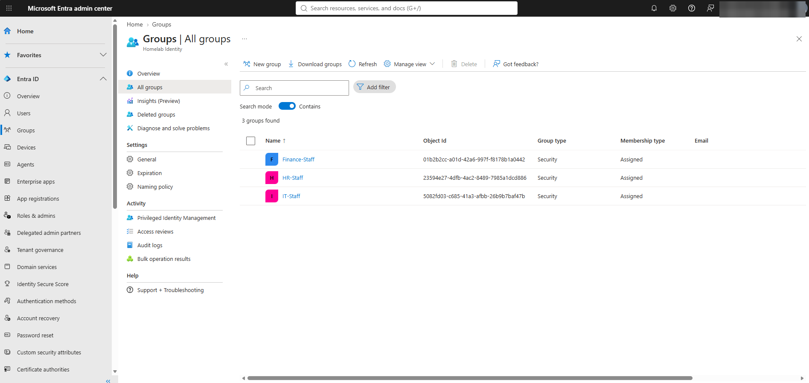
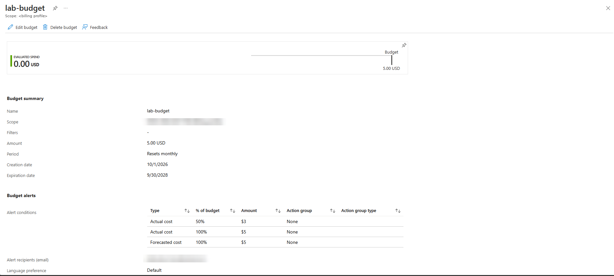
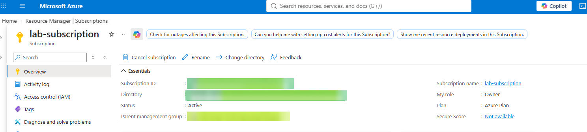
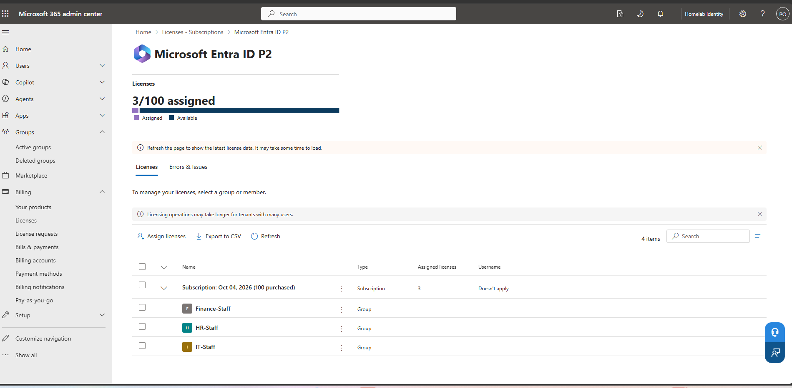
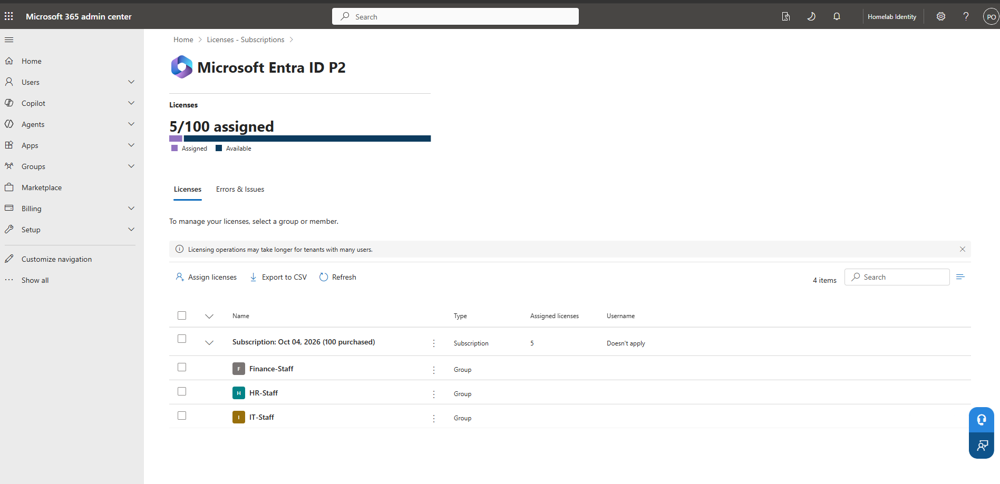
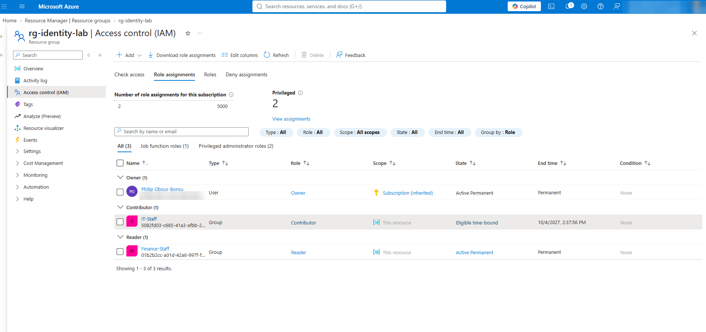
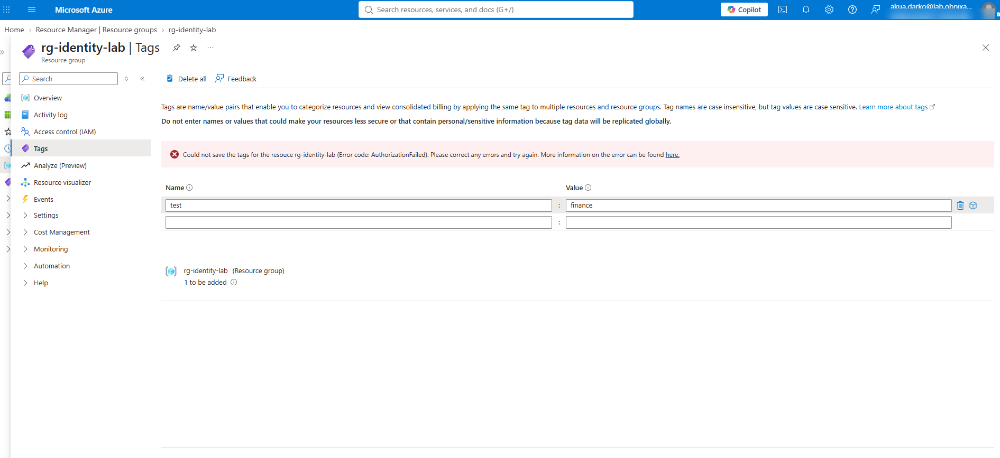
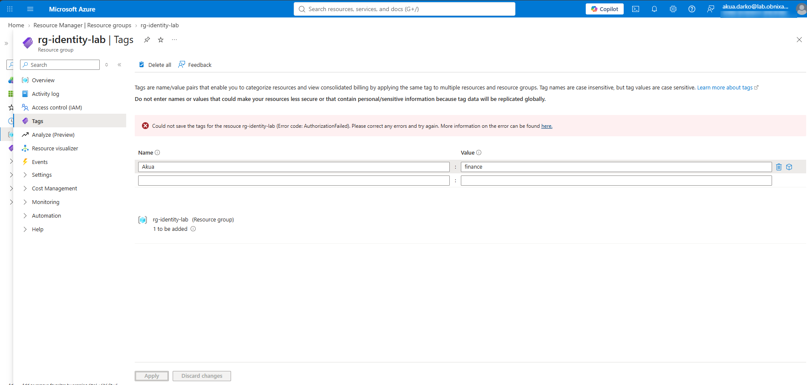
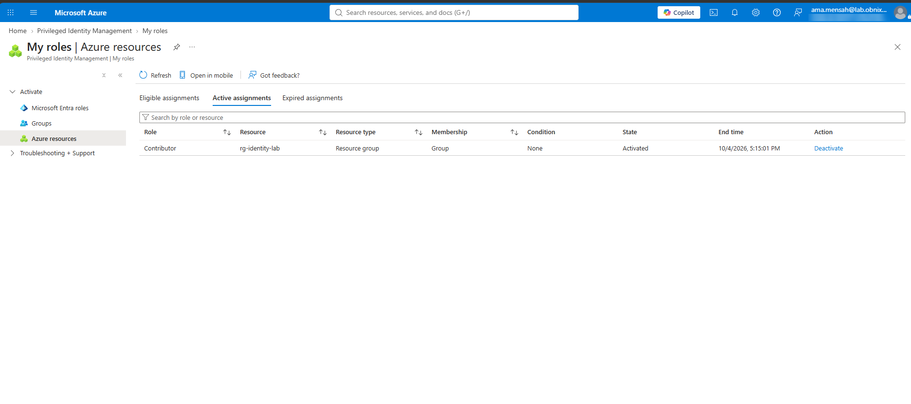
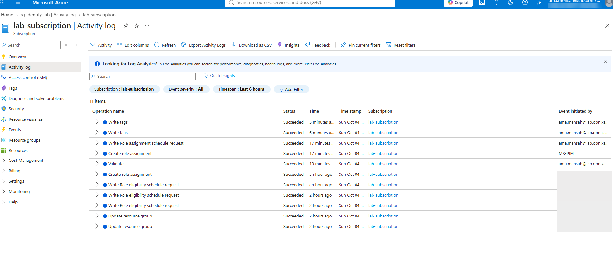

# Phase 3: Cloud access control

**Status: in progress.** Steps 1 to 4 (groups, subscription, P2 licensing, RBAC with PIM) are done and tested. Conditional Access (step 5) and Terraform (step 6) are next.

Goal: access to Azure is controlled entirely by the groups synced from on-prem AD. IT can manage the lab resources, Finance can only look, and privileged access is just-in-time.

## Progress

| Step | Task | Status |
| --- | --- | --- |
| 1 | Confirm AD groups synced to Entra | Done |
| 2 | Azure subscription + budget | Done |
| 3 | Microsoft Entra ID P2 trial, licensed by group | Done |
| 4 | RBAC by hand: IT Contributor (PIM eligible), Finance Reader (active) | Done, tested |
| 5 | Conditional Access: break-glass account, require MFA, block legacy auth, risk-based MFA | Next |
| 6 | Same RBAC in Terraform, `terraform plan` shows no drift | Planned |

## Step 1: Synced groups

IT-Staff, Finance-Staff and HR-Staff appear in Entra as **Security** groups with **Source: Windows Server AD**. They live in the LabUsers OU, so Cloud Sync brought them over with the users. Group membership is still managed in AD.

## Step 2: Azure subscription

| Item | Value |
| --- | --- |
| Subscription | `lab-subscription` (Microsoft Azure Plan, pay-as-you-go) |
| Owner | Cloud admin account |
| Budget | $5/month at billing-account scope, email alerts at 50%, 100% and forecasted 100%, plus a subscription budget alerting at 80% |
| Expected cost | About $0: resource groups, role assignments and tags are free |

**What happened along the way:**

- **No free credit.** The account had already used its Azure free trial in 2025 (the sign-up credit had expired), so the billing account had to be **upgraded to pay-as-you-go** before any subscription could be created. Support plan: Basic (included, free).
- **Subscription requested for another owner.** The subscription was created by the personal billing account with the cloud admin as owner, which produces an ownership request the cloud admin must accept (via the *Accept ownership URL*).
- **Blocked by a tenant policy.** Acceptance failed with `blockSubscriptionsIntoTenant`: the tenant's subscription policy allows no users, except *elevated* Global Admins, to bring subscriptions in. Instead of loosening the policy, the cloud admin was **temporarily elevated** (*Access management for Azure resources*), accepted the subscription, then had elevation turned back off.

## Step 3: Entra ID P2 trial

- Microsoft Entra ID P2 trial (100 licenses, 1-month term) activated through the Microsoft 365 admin center. The payment method is used only for identity verification.
- **Licensed by group**, not by user: IT-Staff, Finance-Staff and HR-Staff. Anyone added to these groups in AD is licensed automatically. Licence assignment now happens only in the Microsoft 365 admin center; Entra links there.

- An earlier offer of the same trial auto-converted to a paid 1-year subscription; that path was avoided in favour of the admin-center trial, with the term set to 1 month and a reminder before it ends.

## Step 4: RBAC by hand, with PIM

Resource group `rg-identity-lab` in `lab-subscription`.

| Group | Role | Assignment | Meaning |
| --- | --- | --- | --- |
| IT-Staff | Contributor | **Eligible** (PIM), 1 year | Must activate just-in-time before use |
| Finance-Staff | Reader | **Active**, permanent | Standing read access |

With P2 active, the portal created both assignments as **Eligible** by default. Read access doesn't need just-in-time control, so the Finance assignment was removed in PIM and re-added as Active. Privileged write access stays just-in-time.

### Tests

Both tests write a **tag** on the resource group, which costs nothing.

| Test | User | Result |
| --- | --- | --- |
| Finance cannot change | Akua (Finance-Staff, Reader) | Can see the resource group; saving a tag fails with `AuthorizationFailed` |
| IT must activate first | Ama (IT-Staff, eligible Contributor) | PIM -> My roles -> Activate Contributor for 1 hour with a reason; tag saved successfully |

The resource group's activity log shows the full just-in-time chain:

| Event | Initiated by |
| --- | --- |
| Write role eligibility schedule request (IT eligible) | Cloud admin |
| Create role assignment (Finance Reader, active) | Cloud admin |
| Write role assignment schedule request (Ama activates) | Ama |
| Create role assignment (temporary Contributor) | **MS-PIM** |
| Write tags: Succeeded | Ama |

The activation expires on its own after one hour.

### Identity Protection surprise

Ama's first cloud sign-in was blocked: *"We've detected something unusual about this sign-in."* With P2 active, **Identity Protection** marked her as a **risky user** (new user, new device, no MFA registered), and with no MFA she couldn't prove her identity. The cloud admin reviewed the risk and dismissed it; Ama then registered Microsoft Authenticator. Step 5 adds a risk-based Conditional Access policy so users can self-remediate with MFA instead of needing an admin.

Related lesson: removing a user's Authenticator entry from the phone locks them out. The fix is an admin deleting the stale method under **Authentication methods** so the user can register again.

## Planned: Step 5, Conditional Access

| Policy | Users | Control |
| --- | --- | --- |
| Break-glass account | Cloud-only Global Admin, excluded from all policies | Long random password in a password manager, MFA registered |
| CA01 Require MFA | All users except break-glass | Grant: require MFA (replaces security defaults, which must be turned off) |
| CA02 Block legacy authentication | All users except break-glass | Block Exchange ActiveSync and other legacy clients |
| CA03 Risky sign-ins | All users except break-glass | Medium/high sign-in risk: require MFA (self-remediation) |

## Planned: Step 6, RBAC as code

Recreate the resource group and both role assignments in Terraform (`azurerm_resource_group`, `azurerm_role_assignment`, with PIM eligibility via `azurerm_pim_eligible_role_assignment`), then confirm `terraform plan` reports no changes against the hand-built setup.
