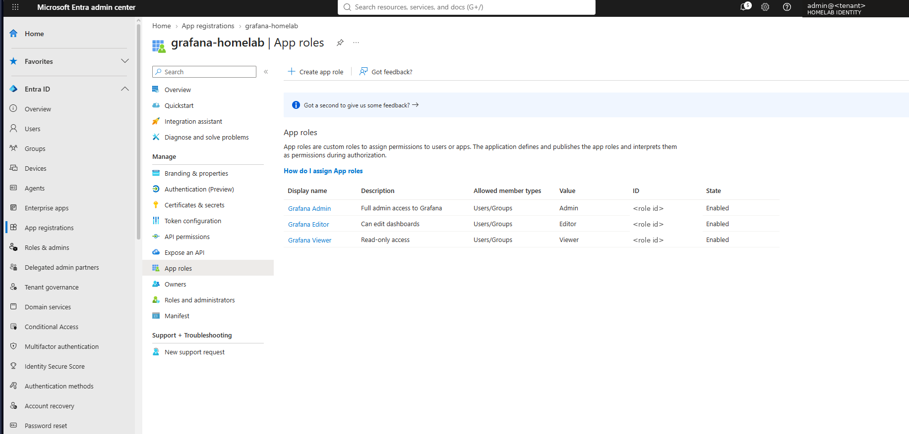
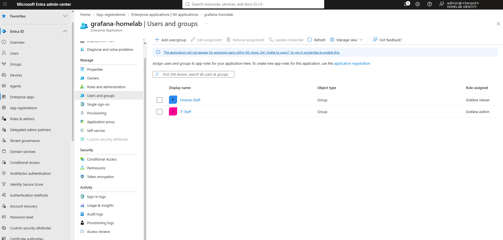
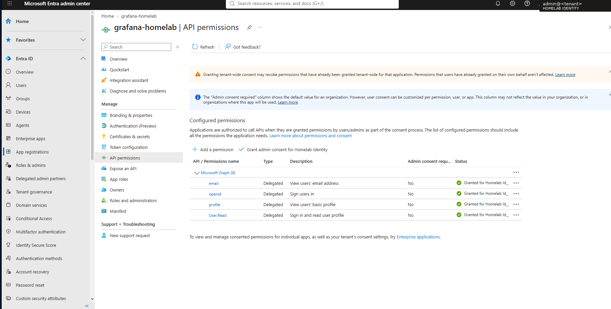
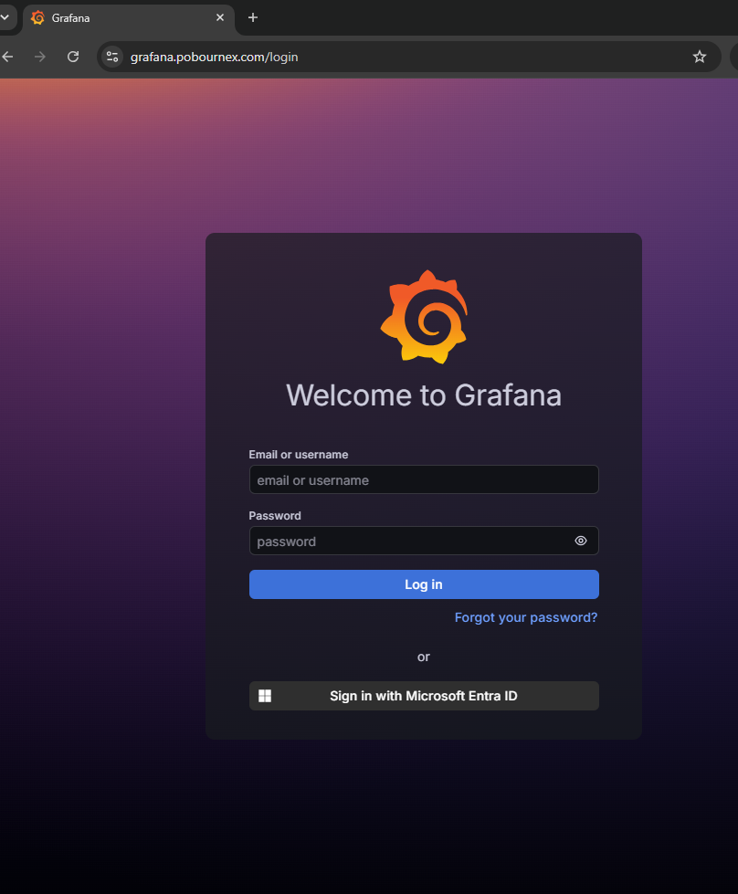
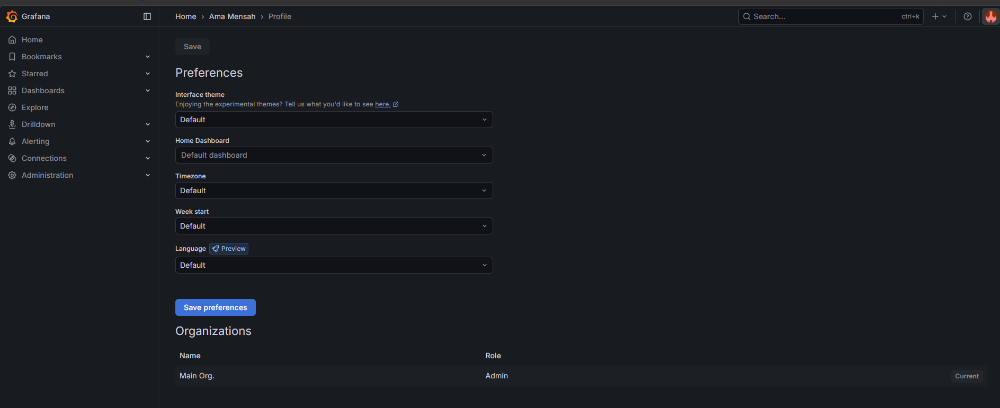
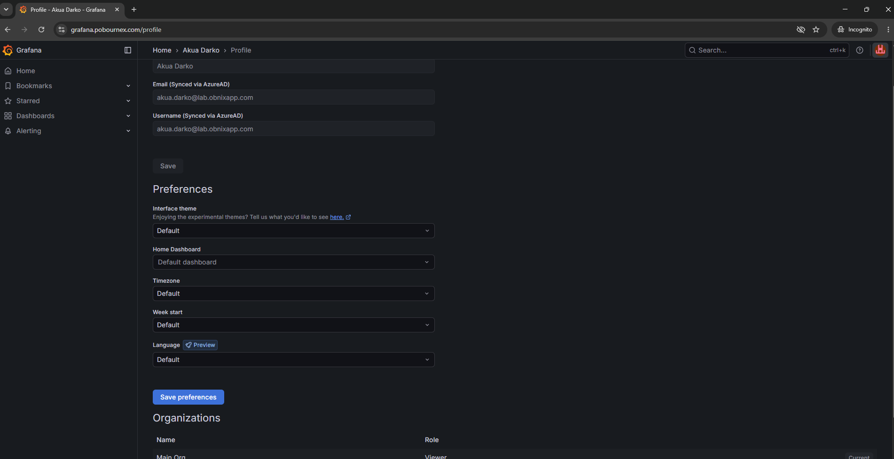
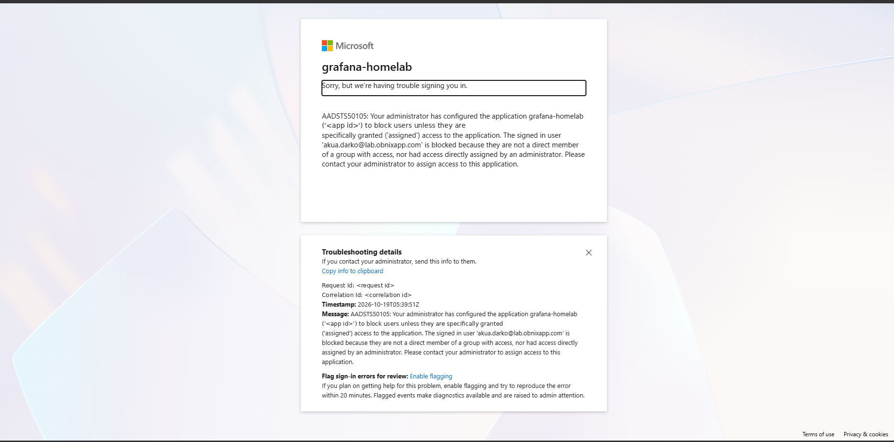

# Phase 4: Multi-cloud and app SSO

**Status: in progress.** Step 1 (Grafana) is done and tested. AWS IAM Identity Center, Proxmox and Argo CD are next.

Goal: one Entra ID sign-in, with the same MFA and Conditional Access, reaches Azure, AWS and the homelab apps. What each user can do in each app comes from their AD group.

## Progress

| Step | Task | Status |
| --- | --- | --- |
| 1 | Grafana SSO (OIDC) with roles from AD groups | Done, tested |
| 2 | AWS IAM Identity Center (SAML + SCIM) | Planned |
| 3 | Proxmox SSO (OpenID realm) | Planned |
| 4 | Argo CD SSO (OIDC) | Planned |
| 5 | Disable a user in AD, confirm access is lost everywhere | Planned |

## Step 1: Grafana

Grafana runs on the homelab K3s cluster (kube-prometheus-stack Helm chart, release `monitoring`, Grafana 12.3). It now signs users in with Entra ID and maps their AD group to a Grafana role.

### Design

| Item | Setting |
| --- | --- |
| URL | `https://grafana.pobournex.com` (LAN only: Cloudflare **DNS-only** A record to the ingress-nginx IP) |
| TLS | Let's Encrypt certificate from cert-manager, `letsencrypt-dns` ClusterIssuer (Cloudflare DNS-01, nothing exposed to the internet) |
| Entra app | App registration `grafana-homelab`, single tenant, redirect URI `/login/azuread` |
| Roles | App roles `Admin`, `Editor`, `Viewer`; IT-Staff → Admin, Finance-Staff → Viewer |
| Access | *Assignment required* = Yes: only assigned groups can sign in |
| Consent | Admin consent granted once for `openid`, `email`, `profile`, `User.Read` (user consent is disabled in the tenant) |
| Secrets | Client secret and local admin password in Kubernetes Secrets, never in Helm values or git |
| Grafana | `role_attribute_strict: true`, so a user with no role is refused |
| MFA | Enforced by Conditional Access CA01, no Grafana-side config |

### Build steps






1. **HTTPS first.** Entra only accepts HTTPS redirect URIs. Grafana was served on `http://192.168.40.156`, so a certificate was issued on the existing ingress:
   ```bash
   kubectl -n monitoring annotate ingress grafana-ingress cert-manager.io/cluster-issuer=letsencrypt-dns
   kubectl -n monitoring patch ingress grafana-ingress --type=merge \
     -p '{"spec":{"tls":[{"hosts":["grafana.pobournex.com"],"secretName":"grafana-tls"}]}}'
   ```
2. **Entra app registration** `grafana-homelab`, three app roles, client secret (6 months), groups assigned in *Enterprise applications*.
3. **Secrets** (typed at a hidden prompt, one line at a time):
   ```bash
   read -rsp "Grafana client secret: " CS; echo
   kubectl -n monitoring create secret generic grafana-azuread --from-literal=client-secret="$CS"; unset CS
   read -rsp "New Grafana admin password: " PW; echo
   kubectl -n monitoring create secret generic grafana-admin \
     --from-literal=admin-user=admin --from-literal=admin-password="$PW"
   ```
4. **Helm values** (`grafana-sso.yaml`, IDs replaced with placeholders here):
   ```yaml
   grafana:
     envValueFrom:
       GF_AUTH_AZUREAD_CLIENT_SECRET:
         secretKeyRef: { name: grafana-azuread, key: client-secret }
     admin:
       existingSecret: grafana-admin
       userKey: admin-user
       passwordKey: admin-password
     grafana.ini:
       server:
         root_url: https://grafana.pobournex.com
       auth.azuread:
         name: Microsoft Entra ID
         enabled: true
         allow_sign_up: true
         client_id: <client-id>
         scopes: openid email profile
         auth_url: https://login.microsoftonline.com/<tenant-id>/oauth2/v2.0/authorize
         token_url: https://login.microsoftonline.com/<tenant-id>/oauth2/v2.0/token
         allowed_organizations: <tenant-id>
         role_attribute_strict: true
         use_pkce: true
   ```
   ```bash
   helm upgrade monitoring prometheus-community/kube-prometheus-stack --version 82.2.0 \
     -n monitoring --reuse-values -f grafana-sso.yaml
   kubectl -n monitoring exec deploy/monitoring-grafana -c grafana -- grafana cli admin reset-admin-password "$PW"; unset PW
   ```



### Problems worked through

- **No HTTPS, so no SSO.** Grafana was HTTP on a LoadBalancer IP. Fixed with a cert-manager certificate on the ingress (above).
- **Ingress pointed at a controller that no longer exists.** The ingress was still marked for Traefik, which had been replaced by ingress-nginx (`192.168.40.152`); its status showed stale node IPs. Moved it to `ingressClassName: nginx` and pointed DNS at the nginx IP.
- **Old hosts-file entries won over DNS.** `nslookup` returned the right IP, but the browser and curl timed out. The Windows hosts file had three old lines sending `grafana.pobournex.com` to retired IPs. Removing them fixed it. Lesson: `nslookup` bypasses the hosts file; check it when DNS "works" but nothing connects.
- **"Need admin approval".** User consent is disabled in the tenant (the safer default), so the first sign-in stopped. An admin granted consent once for the four delegated Graph permissions.
- **Weak local admin password.** Replaced with a strong one from a Kubernetes Secret; the local `admin` is now the break-glass login for Grafana.

### Tests

| Test | User | Result |
| --- | --- | --- |
| IT gets Admin | Ama (IT-Staff) | MFA, then Grafana role **Admin** |
| Finance gets Viewer | Akua (Finance-Staff) | MFA, then **Viewer**; Explore, Connections and Administration hidden; profile shows "Synced via AzureAD" |
| Unassigned group is refused | Akua, with Finance-Staff removed from the app | **AADSTS50105**: not assigned to `grafana-homelab`; access restored by re-adding the group |









Removing a group from the app in Entra cut off access on the next sign-in, with no change in Grafana.

### Open issue: password hash sync for a reset password

A password reset in AD for Esi (HR-Staff) did not reach Entra after more than 20 minutes, although password hash sync is enabled, the agent service runs, and wind01 reaches Entra on port 443 with correct time. The agent log shows earlier "failed to establish connection with the service" errors (Oct 11 to 14) and a performance-counter error on every start. Next: check the agent status under *Cloud sync → Agents*, and reinstall the agent if it is inactive.
